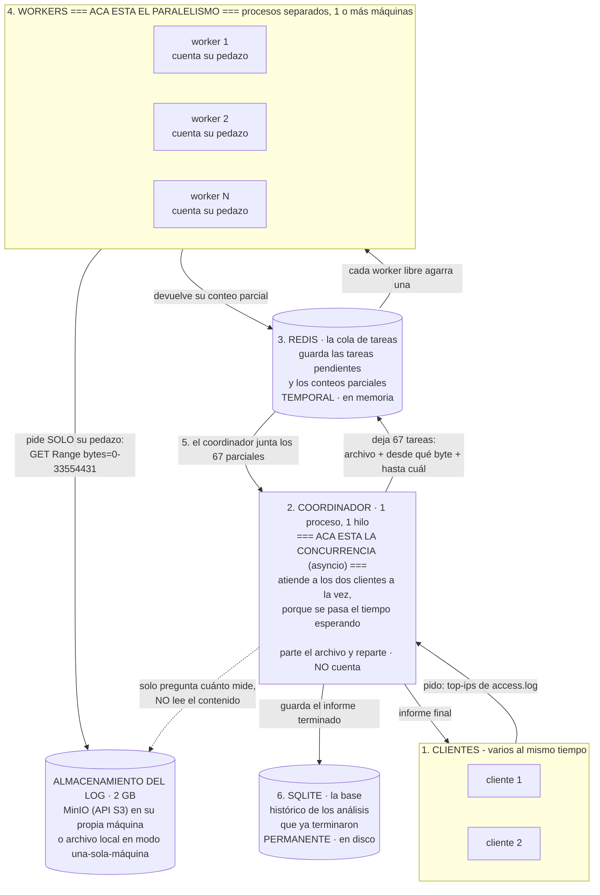

# LogHunter

Analizador **distribuido** de logs web mediante map-reduce.

Trabajo final de **Computación II** — Universidad de Mendoza, Sede San Rafael.
Facultad de Ingeniería, Ingeniería en Informática.

## Propósito

Un servidor web escribe en su `access.log` una línea por cada petición que
atiende: quién la hizo, qué pidió, qué se le respondió y cuántos bytes se le
enviaron. Con tráfico real ese archivo llega a **gigabytes**, y las preguntas
que importan —¿quién consume más?, ¿qué endpoints se usan?, ¿está sano el
servicio?, ¿cuándo son los picos?— no se pueden responder leyéndolo de
corrido en una sola máquina.

LogHunter las responde **partiendo el archivo en tramos de bytes y
procesándolos en paralelo** en varios procesos que pueden vivir en máquinas
distintas a la del log. Un cliente pide un análisis por TCP, un coordinador
calcula los cortes y reparte el trabajo por una cola, los workers cuentan
cada uno su pedazo, y el coordinador suma los parciales en un informe único
que además queda persistido.

El objeto de la evaluación son **los mecanismos**, no el resultado: el
proyecto hace convivir a propósito dos modelos de concurrencia distintos,
porque resuelven problemas distintos.

| | Dónde | Por qué |
|---|---|---|
| **Concurrencia** (`asyncio`) | `coordinador.py` | Es **I/O-bound**: se pasa el tiempo esperando sockets y resultados. Un solo hilo atiende N clientes sin el costo de procesos ni *data races* |
| **Paralelismo** (procesos) | workers Celery | Es **CPU-bound**: aplicar expresiones regulares a millones de líneas es cálculo puro, y el GIL impide paralelizarlo con hilos |

Consultas disponibles: `top-ips`, `status`, `urls`, `traffic`.

## Arquitectura



Las tres propiedades que sostienen el diseño:

1. **Por la cola viajan coordenadas, no datos.** Se encola
   `(uri, inicio, fin)`, nunca los bytes del tramo: mandar los datos
   significaría empujar GB por Redis. Cada worker resuelve el acceso por su
   cuenta, y por eso **nada lo ata a la máquina del archivo**.
2. **El coordinador no lee el contenido del log.** Solo pide su tamaño y
   divide por aritmética. La alineación a fin de línea la hace cada worker
   sobre su propio tramo, de modo que los registros quedan **disjuntos y
   cubren el archivo completo**.
3. **El event loop nunca se bloquea.** Toda llamada bloqueante sale del loop
   —a un hilo auxiliar o al proceso indexador, único escritor de SQLite—
   porque un `INSERT` lento dentro del loop congelaría la atención de todos
   los clientes.

## Uso rápido

Con todo levantado por Compose (ver [INSTALL.md](INSTALL.md)):

```bash
docker compose up -d --scale worker=2

uv run --locked python -m loghunter.generar -o s3://logs-demo/access.log --size-mb 20 --seed 7
uv run --locked python -m loghunter.cliente -f s3://logs-demo/access.log -q top-ips --top 10
```

El paso a paso para levantarlo, ejecutar cada comando y probarlo —con
ejemplos y salidas reales— está en
[doc/final/OPERACION.md](doc/final/OPERACION.md).

## Documentación

| Archivo | Contenido |
|---|---|
| [doc/final/OPERACION.md](doc/final/OPERACION.md) | Cómo levantarlo y probarlo: qué hace cada comando, sus parámetros, un ejemplo ejecutable de cada operación con su salida real, y una secuencia de pruebas para la defensa |
| [doc/final/EXPLICACION_CODIGO.md](doc/final/EXPLICACION_CODIGO.md) | Explicación del código archivo por archivo, los conceptos de concurrencia y paralelismo, el particionado en profundidad y el flujo de punta a punta |
| [Índice de ADR](doc/adr/INDEX.md) | Las 15 decisiones de arquitectura y tecnología, con alternativas consideradas y consecuencias aceptadas |
| [INFO.md](INFO.md) | Resumen de las decisiones de diseño y su justificación, enlazando los ADR |
| [INSTALL.md](INSTALL.md) | Entorno, dependencias, servicios externos, despliegue con Compose y workers remotos |
| [TODO.md](TODO.md) | Mejoras futuras, a partir del alcance excluido y de los límites reconocidos |
| [Skill de GitHub](.claude/skills/flujo-github/SKILL.md) | Conventional Commits y PRs de issue a milestone, develop y main |

## Desarrollo local

Con Python 3.12 y uv instalados:

```bash
uv sync --locked --python 3.12
uv run --locked python -m pytest
```

`uv` crea `.venv/` dentro del checkout y utiliza `uv.lock` para reproducir las
dependencias. La guía completa, incluido el despliegue con Docker Compose,
está en [INSTALL.md](INSTALL.md).

> **Nota sobre `pytest`:** bajá Compose antes de correr la suite. Los tests de
> integración usan contenedores con nombres fijos y los paran a propósito para
> probar fallos; con Compose arriba, sus workers compiten por la misma cola.
> Los tres escenarios válidos están en
> [OPERACION.md §6](doc/final/OPERACION.md).
