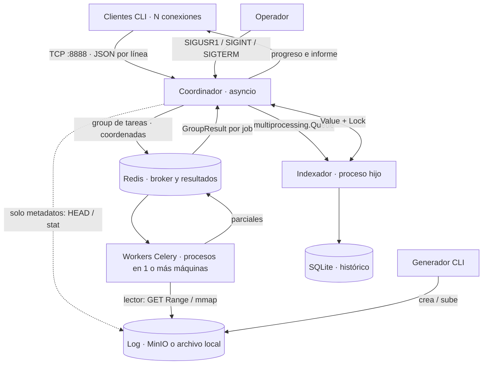

# LogHunter — especificación del proyecto

Fecha: 2026-11-02. Estado: especificación para desarrollo; aplicación todavía sin implementar.

## 1. Propósito y autoridad del documento

Este documento reúne el objetivo, alcance, arquitectura, contratos, comportamiento
esperado y criterios de aceptación de LogHunter. Debe permitir desarrollar la
aplicación como una especificación autónoma.

Los requisitos académicos necesarios de la
[consigna de Computación II](../../UM_C2/FINAL.md) están reproducidos aquí;
ese archivo externo no es una dependencia para implementar el sistema.

Esta especificación define el contrato de implementación. La complementan
[USE_CASES.md](USE_CASES.md), con los escenarios verificables, y el
[índice de ADR](adr/INDEX.md), con los fundamentos de las decisiones. La sección
17 resume las reglas técnicas que deben preservarse. Un cambio posterior de
alcance debe actualizar esta especificación, los casos afectados y su ADR.

## 2. Problema, objetivo y resultados esperados

Un servidor web produce un archivo de texto con una petición por línea. Para
obtener estadísticas de archivos del orden de gigabytes hay que examinar muchas
líneas independientes. LogHunter distribuye ese cómputo entre procesos y permite
que varios usuarios soliciten análisis concurrentemente.

El objetivo es construir una aplicación cliente-servidor de análisis de logs con
map-reduce: cada tarea procesa un rango del archivo y produce un agregado parcial;
el coordinador reúne los agregados en un informe. Se debe poder agregar capacidad
de procesamiento en otras máquinas sin cambiar ni reiniciar el coordinador.

El resultado incluye estadísticas, progreso, cantidad de líneas válidas e inválidas,
métricas de ejecución e histórico consultable. El proyecto debe demostrar el uso
correcto de los mecanismos de la materia, además de obtener resultados correctos.

| Requisito académico | Implementación exigida |
|---|---|
| Sockets con múltiples clientes concurrentes | TCP con `asyncio.start_server` |
| Asincronismo de I/O | Corrutinas y esperas que no bloquean el event loop |
| IPC | `multiprocessing.Queue`, `Value` + `Lock`, señales POSIX y `mmap` local |
| Cola distribuida | Celery con Redis como broker y backend de resultados |
| Argumentos de consola | `argparse` y CLI propia de Celery |
| Extras incluidos en el alcance | SQLite y Docker Compose |

## 3. Alcance

### 3.1 Incluido

- Cliente CLI con cuatro consultas, progreso, tabla de resultados y salida JSON.
- Coordinador que atiende múltiples clientes, limita análisis simultáneos,
  calcula rangos, despacha tareas y realiza el reduce.
- Workers Celery sin estado de aplicación, ejecutables en varias máquinas.
- Lector por rangos con backend local (`mmap`) y remoto (API S3 de MinIO).
- Correlación por pedido, errores aislados y timeout por análisis.
- Indexador como proceso hijo, único escritor de SQLite; histórico de informes.
- Generación reproducible de logs sintéticos, incluyendo registros corruptos.
- Inspección por señales y apagado ordenado.
- Despliegue con Docker Compose y demostración de distribución entre máquinas.
- Verificación de corrección y medición reproducible con 1, 2 y 4 procesos de cómputo.

### 3.2 Excluido

- Autenticación o autorización de los clientes de LogHunter.
- Interfaz web o gráfica.
- Seguimiento en vivo (`tail -f`) o análisis de archivos en modificación.
- Formatos distintos del *combined log format* de Apache/Nginx.
- Logs comprimidos, por ejemplo `.gz`.
- Replicación o alta disponibilidad de MinIO, Redis o el coordinador.
- Recuperación de jobs tras reiniciar el coordinador, entrega exactamente una vez
  de extremo a extremo y persistencia confirmada antes de responder.

Los logs deben estar disponibles antes del análisis y permanecer inmutables hasta
su finalización. La copia de logs desde servidores web no forma parte del sistema.
En la demo, `generar.py` puede crearlos directamente en el destino elegido.

## 4. Tecnologías y entorno

| Tecnología | Uso |
|---|---|
| CPython 3.12 | Base de ejecución elegida para el desarrollo, con GIL convencional |
| `asyncio` | Servidor TCP, corrutinas, semáforo, tareas de supervisión y señales |
| `json`, UTF-8 | Serialización de mensajes de red y de tareas/resultados |
| Celery con soporte Redis (`celery[redis]`) | Despacho y ejecución distribuida con pool de procesos `prefork` |
| Redis | Broker y backend de resultados, configurados explícitamente |
| MinIO | Servicio de objetos compatible con S3, una instancia |
| `boto3` | `HEAD`, lectura por `GET Range` y subida de logs |
| `mmap`, `os` | Lecturas locales por rango y consulta de tamaño |
| `re`, `datetime`, `ipaddress`, `collections.Counter` | Parseo, validación y agregación |
| `multiprocessing` | Proceso indexador, cola y contadores con locks |
| `sqlite3` | Persistencia transaccional del histórico |
| `argparse`, `signal`, `logging`, `uuid`, `time` | CLI, control, diagnóstico, identificación y mediciones |
| Docker y Docker Compose | Entorno reproducible de servicios y escalado local |
| `pytest` | Pruebas de corrección y de integración durante el desarrollo |

La plataforma objetivo es Linux; el desarrollo en macOS debe funcionar donde las
dependencias lo permitan. Las señales POSIX no imponen soporte nativo de Windows.
Fijar versiones compatibles de dependencias e imágenes al preparar el entorno;
registrarlas en el proyecto y en `INSTALL.md`. No depender de etiquetas `latest`.
La disponibilidad de la imagen de MinIO elegida debe verificarse al implementar;
una dificultad de distribución no autoriza a cambiar la arquitectura sin un ADR.

## 5. Arquitectura y comunicación



| Canal | Datos y reglas |
|---|---|
| Cliente ↔ coordinador | Un pedido por conexión TCP; progreso y un mensaje terminal; JSON UTF-8 delimitado por `\n`; IPv4 e IPv6 |
| Coordinador → Redis → worker | URI, rango `[inicio, fin)`, consulta y `job_id`; nunca bytes del log |
| Worker → Redis → coordinador | Contador parcial, totales de líneas y metadatos de ejecución |
| Coordinador → almacenamiento | Solo tamaño/metadatos, sin leer contenido |
| Worker → almacenamiento | Su rango y bytes auxiliares necesarios para los límites de línea |
| Coordinador → indexador | Informe agregado por cola local entre procesos |
| Operador → coordinador | Señales para diagnóstico y apagado |

El estado de jobs vive en el coordinador. Redis tiene estado transitorio de tareas,
SQLite tiene estado persistente de informes y MinIO conserva los archivos fuente.
Los workers no conservan contadores entre tareas.

## 6. Responsabilidades y organización del código

El paquete debe llamarse `loghunter` y permitir `python -m loghunter.<modulo>`.
Se pueden crear módulos auxiliares para protocolo, configuración, parser o consultas
sin alterar estas responsabilidades:

| Módulo | Responsabilidades y límites |
|---|---|
| `cliente.py` | Validar argumentos, normalizar URI, conectar, enviar, consumir progreso y presentar informe. No lee el log ni usa Redis. |
| `coordinador.py` | Validar pedidos, administrar jobs y semáforo, obtener tamaño, calcular rangos, despachar `group`, supervisar resultados, reducir, responder y encolar persistencia. No parsea el log. |
| `tasks.py` | Configurar la aplicación Celery y exponer `map_chunk(uri, inicio, fin, query, job_id)`. Leer y alinear registros, parsear, contar y devolver datos serializables. No escribir SQLite. |
| `lector.py` | `abrir(uri)`, `tamano()`, `leer(inicio, fin)` y `leer_hasta_salto(desde, max_bytes)`. Seleccionar backend y cerrar recursos. No interpretar registros. |
| `indexador.py` | Crear esquema, consumir cola, guardar informe y resultados en una transacción, actualizar métricas tras commit. |
| `generar.py` | Crear un log reproducible de tamaño configurable en disco o MinIO, sin acumular todo el archivo en RAM. |

El lector es un módulo usado por otros procesos, no un servicio ni un proceso
adicional. El coordinador inicia el indexador; el operador inicia los workers.

## 7. Entrada, consultas y ejemplos verificables

### 7.1 Formato y parseo

Ejemplo de registro válido:

```text
192.168.1.45 - - [20/Oct/2026:14:32:11 -0300] "GET /api/users HTTP/1.1" 200 1534 "-" "curl/8.1"
```

El parser debe extraer IP, timestamp con offset, método, destino solicitado, estado
HTTP y bytes. Validar la línea completa y sus campos: IP válida (IPv4 o IPv6),
fecha válida, estado de tres dígitos entre 100 y 599 y bytes enteros no negativos
o `-`. `-` en bytes representa cero bytes contabilizados. El parser debe admitir
escapes en campos entre comillas del formato combined, sin depender del locale
del sistema para los meses en inglés.

Procesar límites sobre bytes, antes de decodificar. Decodificar cada registro con
UTF-8 estricto; una línea con codificación o estructura inválida suma una inválida.
Aceptar LF y CRLF. La última línea sin salto final también es un registro. Una
línea vacía es inválida; un archivo vacío tiene cero registros.

`lineas` significa **registros válidos**; `invalidas`, registros inválidos;
`lineas_totales = lineas + invalidas`. Una línea inválida no aporta a las consultas.

### 7.2 Semántica de las consultas

| Nombre | Clave del agregado | Valor | Presentación |
|---|---|---|---|
| `top-ips` | IP normalizada con `ipaddress` | Cantidad de peticiones | Mayor cantidad primero; aplicar `--top` |
| `status` | Código HTTP como cadena | Cantidad de respuestas | Todos los códigos, orden numérico ascendente |
| `urls` | Destino solicitado tal como aparece, incluyendo query string | Cantidad de peticiones | Mayor cantidad primero; aplicar `--top` |
| `traffic` | Fecha y hora UTC, por ejemplo `2026-10-20T17:00:00Z` | Suma de bytes | Todas las horas presentes, orden cronológico |

Para empates en rankings ordenar por clave ascendente. No calcular el top dentro
de cada worker: todos devuelven sus contadores completos y el recorte se aplica
después del reduce. `--top` no recorta `status` ni `traffic`. No agrupar solo por
número de hora: mezclaría días distintos. No normalizar ni eliminar parámetros de
URLs. Estas son precisiones adoptadas; véase [ADR-0011](adr/0011-formato-y-consultas.md).

### 7.3 Ejemplo de entrada y resultados esperados

```text
10.0.0.1 - - [20/Oct/2026:14:00:00 -0300] "GET /a HTTP/1.1" 200 100 "-" "demo"
10.0.0.2 - - [20/Oct/2026:14:05:00 -0300] "GET /b HTTP/1.1" 404 200 "-" "demo"
10.0.0.1 - - [20/Oct/2026:14:10:00 -0300] "GET /a HTTP/1.1" 200 50 "-" "demo"
10.0.0.2 - - [20/Oct/2026:15:00:00 -0300] "GET /a?x=1 HTTP/1.1" 500 - "-" "demo"
10.0.0.1 - - [20/Oct/2026:15:15:00 -0300] "GET /a HTTP/1.1" 200 300 "-" "demo"
registro corrupto
```

Resultados, independientemente del tamaño de tramo o número de procesos:

- Válidas: 5; inválidas: 1; total: 6.
- `top-ips`: `10.0.0.1 → 3`, `10.0.0.2 → 2`.
- `status`: `200 → 3`, `404 → 1`, `500 → 1`.
- `urls`: `/a → 3`, `/a?x=1 → 1`, `/b → 1`.
- `traffic`: `2026-10-20T17:00:00Z → 350`, `2026-10-20T18:00:00Z → 300`.

## 8. Rangos y lectura correcta del archivo

### 8.1 Unidades y división

Conservar los flags `--chunk-mb` y `--size-mb`; su unidad será MiB (`2**20` bytes)
y debe explicitarse en la ayuda. Sean `S` el tamaño en bytes y `C` el tamaño de
tramo: generar `[i, min(i+C, S))` para `i = 0, C, 2C, ... < S`.
La cantidad de tareas es `ceil(S/C)`. Un archivo vacío no genera tareas.

Ejemplo: 128 MiB con tramos de 32 MiB produce cuatro tareas:

```text
[0, 33554432)
[33554432, 67108864)
[67108864, 100663296)
[100663296, 134217728)
```

Dos GiB con tramos de 32 MiB producen **64 tareas**. La cantidad siempre debe
calcularse a partir del tamaño real del archivo y del tramo configurado.
Los tramos son tareas, no archivos nuevos; cuatro tareas tampoco implican cuatro
workers obligatorios.

### 8.2 Propiedad de cada registro

Una línea pertenece al tramo que contiene **el offset de su primer byte**.
Para una tarea `[inicio, fin)`:

1. Si `inicio == 0`, empezar en cero.
2. Si `inicio > 0`, consultar el byte anterior. Si es `\n`, `inicio` ya es inicio
   de línea y no se descarta nada. En otro caso, avanzar hasta el siguiente `\n`
   o EOF: se está dentro de una línea del tramo anterior.
3. Procesar líneas cuyo primer byte esté antes de `fin`.
4. Completar la última de esas líneas hasta `\n` o EOF, aunque termine después
   de `fin`. Leer extensiones en bloques de 64 KiB cuando haga falta.
5. Si el siguiente inicio encontrado ya está en `fin` o después, devolver cero
   registros para ese tramo. Una línea puede atravesar varios tramos.

Así se evitan pérdidas cuando un corte cae exactamente después de un salto de
línea. Los 64 KiB son una unidad de lectura auxiliar, no una garantía de longitud
máxima. No cortar una línea larga ni contar cada bloque como registro independiente.
Mantener la lectura acotada por bloques; los límites temporales de tarea protegen
frente a entradas patológicas.

### 8.3 Backends

El contrato `leer(inicio, fin)` usa fin exclusivo en ambos backends; validar
`0 <= inicio <= fin <= S` y devolver `b""` para un intervalo vacío.

- **S3:** `s3://logs/access.log` identifica bucket `logs` y key `access.log`.
  Consultar tamaño por `head_object`; traducir `[inicio, fin)` a
  `Range="bytes=inicio-(fin-1)"`. Cerrar el cuerpo HTTP tras leerlo y validar que
  la respuesta corresponde al rango solicitado. Reintentar solo fallos transitorios.
- **Local:** normalizar rutas a `local:///ruta/absoluta`. El archivo debe existir
  en la máquina donde corren coordinador y workers. Usar `mmap.ACCESS_READ`; alinear
  el offset físico a `mmap.ALLOCATIONGRANULARITY` y aplicar el desplazamiento
  interno. No intentar mapear un archivo vacío.

`leer_hasta_salto(desde, max_bytes)` devuelve hasta el primer LF inclusive, o
hasta el límite/EOF; el worker repite la llamada si todavía no encontró LF.
El byte previo y las extensiones son lecturas auxiliares del worker, nunca del
coordinador. La devolución de `bytes` o un slice puede copiar datos aunque se use
`mmap`; no prometer cero copias en todo el parser.

## 9. Concurrencia, tareas y ciclo de vida

### 9.1 Coordinador y admisión

Un proceso mantiene un event loop en un hilo. Puede usar hilos auxiliares mediante
`asyncio.to_thread` para bibliotecas bloqueantes. Eso no convierte la atención de
clientes en un modelo de hilo por conexión.

Sacar del loop las llamadas sincrónicas a Celery/Redis, `boto3`, operaciones de
cola que puedan esperar, `join()` y otras esperas de disco/red. El reduce y la
serialización también deben evitar pausas largas; procesarlos por lotes con cesión
o delegarlos sin compartir estado mutable de jobs con el hilo auxiliar.

Proteger el diccionario de jobs: no usar una secuencia leer → `await` → escribir
sin sincronización. Usar `asyncio.Lock` si la sección necesita esperar.
Usar `asyncio.Semaphore(max_jobs)` para admitir análisis, con liberación en `finally`.
Si todos los permisos están ocupados, informar `queued` y esperar sin encolar
todavía tareas de ese pedido.

### 9.2 Estados e identidad

```text
recibido → validado → queued (si no hay cupo) → running → reducing → completed
                                                └──────────────→ failed
                                                └──────────────→ timed_out
queued / running / reducing ────────────────────────────────────→ cancelled
```

Asignar `job_id = uuid4().hex` al pedido estructuralmente válido y guardar su
socket, URI, consulta, configuración efectiva, tiempos, estado, IDs de tareas y
`GroupResult`. Un grupo pertenece a un solo job. Cada resultado se agrega una
sola vez por ID de tarea; un reintento no es un nuevo parcial sumable.

`completed_count()` cuenta tareas exitosas. `ready()` también puede ser verdadero
si hubo fallos: comprobar los errores y `successful()` antes del reduce. Emitir
progreso de tramos exitosos, monótono, por ejemplo cada segundo; no dejar un job
fallido esperando indefinidamente a que el contador llegue al total.

El timeout empieza al obtener cupo e incluye metadatos, despacho, espera, reduce
y encolado del informe. No incluye la espera de admisión ni el commit posterior.
Usar reloj monotónico para duración/deadline; timestamp UTC para el histórico.
Un archivo vacío produce un resultado exitoso vacío sin esperar un grupo de tareas.

### 9.3 Ejecución y recuperación

Contrato mínimo de resultado de `map_chunk`:

```json
{"contador":{"10.0.0.1":300},"lineas":300,"invalidas":2,"worker":{"hostname":"w1","pid":1234}}
```

`contador` debe contener claves de texto y valores enteros no negativos. El worker
identifica sus logs con `job_id` y task ID. La tarea es idempotente mientras la
entrada sea inmutable, y no produce efectos persistentes.

Configurar explícitamente confirmación tardía y rechazo al perder el proceso
ejecutor (`task_acks_late`, `task_reject_on_worker_lost`). Aplicar reintentos de
lectura transitoria con backoff finito; errores permanentes y de parser de una
línea no deben reintentarse como tareas completas indefinidamente.

Valores iniciales adoptados, configurables por entorno: timeout de conexión S3
5 s, lectura 15 s, hasta 3 reintentos de lectura con backoff; límite duro de tarea
120 s y visibility timeout Redis 180 s. Coordinar estas opciones con el timeout
del job (300 s por defecto); los reintentos no renuevan su deadline. Registrar
la configuración efectiva y verificar recuperación con la versión elegida.
Configurar expiración de tareas según el deadline y retención de resultados de
3600 s inicialmente, siempre mayor que el horizonte del job.

Al vencer el timeout o fallar un tramo definitivamente, revocar tareas pendientes
solo de ese job, marcarlo terminal e ignorar sus resultados tardíos. `revoke()` no
garantiza detener una tarea que ya corre: esta queda limitada por su `time_limit`.
No matar globalmente workers que podrían atender otros jobs. Tras la desconexión
detectada de un cliente, cancelar su job y aplicar la misma limpieza; no hay
reconexión ni consulta remota de un job por ID en esta versión.

Registrar cada task ID antes de publicarlo. Si la publicación del grupo falla
a mitad de camino, limpiar también las tareas ya publicadas: no asumir que un
fallo de `apply_async` significa que ninguna tarea llegó al broker.

## 10. Protocolo de aplicación v1

Una conexión lleva un pedido y cero o más mensajes informativos, seguidos por
exactamente un mensaje terminal si el socket sigue disponible. Todo mensaje es
un objeto JSON UTF-8 terminado en LF. TCP puede fragmentar o juntar mensajes:
leer por delimitador, sin suponer correspondencia entre `send` y `recv`.

### 10.1 Pedido

```json
{"version":1,"type":"analyze","file":"s3://logs/access.log","query":"top-ips","top":10,"chunk_mb":32}
```

`version`, `type`, `file` y `query` son obligatorios. `top` es opcional y vale 10.
`chunk_mb` es opcional: si falta se usa el valor del coordinador. Cliente y servidor
validan tipos (un booleano no es un entero válido), consulta, URI y rangos.
`top` debe ser entero positivo; `chunk_mb`, entero entre 1 y 256 MiB.
Rechazar versiones o campos desconocidos y JSON que no sea un objeto.

Límite inicial del pedido: 64 KiB incluyendo LF. Un pedido que exceda el límite o
termine antes de LF es inválido. El timeout inicial de lectura de pedido será
30 s. Estos límites son del pedido, no del informe final, cuyo tamaño puede ser
mayor con `traffic`; el cliente debe consumirlo sin truncarlo.

### 10.2 Mensajes de respuesta

```json
{"version":1,"type":"accepted","job_id":"abc123","state":"queued"}
{"version":1,"type":"started","job_id":"abc123","chunks":4,"chunk_mb":32}
{"version":1,"type":"progress","job_id":"abc123","completed":2,"total":4}
{"version":1,"type":"result","job_id":"abc123","file":"s3://logs/access.log","query":"top-ips","top":10,"chunk_mb":32,"tamano_bytes":134217728,"chunks":4,"workers":2,"lineas":5,"invalidas":1,"lineas_totales":6,"duracion":1.25,"resultados":[{"clave":"10.0.0.1","valor":3},{"clave":"10.0.0.2","valor":2}],"persistencia":"encolada"}
```

Los mensajes anteriores ilustran el esquema, no métricas medidas. Un pedido con
cupo recibe `accepted` con `state: "admitted"`, seguido de `started` cuando se
conoce el número de tramos. Para vacío, `chunks=0`, `workers=0` y `resultados=[]`.
Los IDs reales son UUID hexadecimales; `abc123` es una abreviatura de ejemplo.
`duracion` está en segundos, desde la admisión hasta terminar el reduce; excluye
espera de cupo, encolado/persistencia y transmisión al cliente. El deadline del
job sí sigue vigente durante el encolado. `workers` cuenta pares `(hostname, pid)` distintos
en los parciales exitosos; es cantidad observada de procesos participantes, no
concurrencia máxima ni cantidad de nodos Celery. Puede ser `null` si no se pudo medir.

Ejemplo terminal de error:

```json
{"version":1,"type":"error","job_id":"abc123","code":"JOB_TIMEOUT","message":"El análisis superó el tiempo permitido."}
```

`job_id` es `null` si el error precede a la creación del job. Códigos mínimos:

| Código | Situación |
|---|---|
| `INVALID_REQUEST` | JSON, framing, versión, campos o valores inválidos |
| `UNSUPPORTED_QUERY` | Consulta desconocida |
| `UNSUPPORTED_URI` | Esquema no soportado o log comprimido |
| `FILE_NOT_FOUND` | Archivo/objeto inexistente |
| `FILE_ACCESS_ERROR` | Permisos o lectura imposible |
| `STORAGE_UNAVAILABLE` | Fallo remoto tras reintentos |
| `BROKER_UNAVAILABLE` | No se pudo publicar o recuperar estado/resultados |
| `TASK_FAILED` | Un tramo terminó con fallo definitivo |
| `JOB_TIMEOUT` | Venció el deadline |
| `SERVICE_UNAVAILABLE` | No se puede admitir trabajo, por ejemplo indexador caído |
| `SERVER_SHUTDOWN` | Apagado del coordinador |
| `INTERNAL_ERROR` | Fallo inesperado registrado por el servidor |

La saturación normal produce espera en cola, no `SERVICE_UNAVAILABLE`.
Cerrar la conexión tras el terminal. Un cierre sin terminal se considera fallo
de comunicación. Los logs del servidor conservan el diagnóstico técnico; el
mensaje al usuario debe ser claro y no incluir credenciales ni traceback.

## 11. Persistencia, histórico e IPC local

El coordinador entrega el **agregado completo**, antes del recorte top, al
indexador. El cliente recibe la vista solicitada. Así el histórico conserva el
conteo completo para esa consulta sin guardar cada línea del log.

El indexador mantiene su propia conexión SQLite, habilita claves foráneas y usa
una transacción por informe. Contrato de esquema inicial:

```sql
CREATE TABLE informes (
    id INTEGER PRIMARY KEY AUTOINCREMENT,
    job_id TEXT NOT NULL UNIQUE,
    ts REAL NOT NULL,
    archivo TEXT NOT NULL,
    tamano_bytes INTEGER NOT NULL,
    query TEXT NOT NULL,
    top INTEGER NOT NULL,
    chunk_mb INTEGER NOT NULL,
    chunks INTEGER NOT NULL,
    workers INTEGER,
    lineas INTEGER NOT NULL,
    invalidas INTEGER NOT NULL,
    duracion REAL NOT NULL
);
CREATE TABLE resultados (
    informe_id INTEGER NOT NULL REFERENCES informes(id),
    clave TEXT NOT NULL,
    valor INTEGER NOT NULL,
    PRIMARY KEY (informe_id, clave)
);
```

`ts` es el instante UTC de inicio tras admisión, en epoch segundos. La unicidad de
`job_id` evita duplicar el informe si se repite su entrega; no omitir resultados
de forma silenciosa ante un error. `top` y `chunk_mb` registran la configuración
efectiva. Estos campos permiten relacionar cada resultado con su ejecución.

La respuesta `persistencia: "encolada"` significa entregada a la cola, **no commit
confirmado**. El indexador incrementa informes persistidos solo tras commit.
Si falla una transacción, revierte, registra el `job_id` y el error; no aumenta el
contador de éxito. El coordinador supervisa la vida del hijo y deja de admitir
análisis si este cae. Los jobs que todavía no entregaron su informe fallan con
`SERVICE_UNAVAILABLE` al intentar persistir, sin anunciar un nuevo éxito. Un
informe ya respondido puede perderse ante un fallo del
proceso o del equipo: una cola local no es un registro durable.

El histórico se consulta inicialmente con SQLite en modo lectura, sin agregar
una quinta consulta al protocolo del cliente:

```bash
sqlite3 -readonly informes.sqlite \
  'SELECT job_id, archivo, query, workers, duracion FROM informes ORDER BY ts DESC;'
```

Contadores compartidos mediante `Value` y `Lock`:

| Contador | Quién lo modifica | Momento |
|---|---|---|
| Jobs activos | Coordinador | Admisión y liberación de cupo |
| Informes emitidos | Coordinador | Respuesta terminal exitosa enviada |
| Informes persistidos | Indexador | Transacción confirmada |
| Líneas válidas procesadas | Coordinador | Reduce exitoso, una vez por job |

Proteger tanto lecturas como escrituras con el lock correspondiente. Los hilos
auxiliares no modifican directamente el diccionario de jobs. Crear procesos con
entrypoints protegidos por `if __name__ == "__main__"`; no depender de heredar
conexiones o de `fork` implícito.

## 12. Interfaz de consola y configuración

### 12.1 Cliente

| Opción | Contrato |
|---|---|
| `-i`, `--ip` | Dirección del coordinador; default `127.0.0.1`; IPv4 o IPv6 |
| `-p`, `--port` | Puerto 1–65535; default 8888 |
| `-f`, `--file` | Obligatorio: URI o ruta local |
| `-q`, `--query` | Obligatorio: `top-ips`, `status`, `urls`, `traffic` |
| `--top` | Entero positivo; default 10; afecta rankings |
| `--chunk-mb` | Sugerencia 1–256 MiB; si se omite decide el coordinador |
| `--raw` | Escribir un objeto JSON terminal más LF en stdout |

Convertir una ruta local relativa a absoluta desde el cwd del cliente. Esa
normalización no sube el archivo: en modo local debe existir en el mismo host de
procesamiento. En modo normal, mostrar espera, progreso, tabla y métricas. En
`--raw`, progreso y diagnósticos van a stderr; stdout queda disponible para pipes.
Códigos de salida: 0 éxito, 2 argumentos inválidos, 1 error de servidor o conexión.
Todos los ejecutables propios ofrecen `--help`.

### 12.2 Coordinador

| Opción | Default / validación |
|---|---|
| `-i`, `--ip` | `0.0.0.0`; permitir escucha IPv6 configurada con `::` |
| `-p`, `--port` | 8888; 1–65535 |
| `--chunk-mb` | 32; entero 1–256 MiB |
| `--max-jobs` | 3; entero positivo |
| `--job-timeout` | 300; segundos positivos |
| `--broker` | `redis://localhost:6379/0` |
| `--s3-endpoint` | `http://localhost:9000` |
| `--db` | `informes.sqlite` |

### 12.3 Generador

| Opción | Default / validación |
|---|---|
| `-o`, `--out` | Obligatorio: ruta local, URI local o `s3://bucket/key` |
| `--size-mb` | Obligatorio: entero no negativo, MiB |
| `--ips` | 5000; entero positivo |
| `--corrupt-pct` | 0; número entre 0 y 100 |
| `--seed` | Entero opcional; necesario en pruebas reproducibles |

Generar secuencialmente hasta alcanzar o superar el objetivo, completando la
última línea. Tamaño cero crea un archivo vacío. Informar tamaño exacto, válidas,
inválidas y total generados. Para corrupción, usar selección pseudoaleatoria con
la semilla: el porcentaje observado puede diferir del solicitado. Utilizar fecha
base fija, PRNG local y configuración explícita; la misma semilla y argumentos
deben producir los mismos bytes tanto en destino local como S3. Generar IPs
variadas, mayoría de respuestas 200, algunas 404 y 500, y picos horarios. Los
timestamps deben avanzar de forma monótona. No basarlos en la hora de ejecución.

### 12.4 Entorno compartido y comandos previstos

| Variable | Uso |
|---|---|
| `CELERY_BROKER_URL` | URL de Redis para todos los productores y workers |
| `CELERY_RESULT_BACKEND` | Backend explícito; default `redis://localhost:6379/1` |
| `S3_ENDPOINT` | Endpoint MinIO para coordinador, workers y generador |
| `AWS_ACCESS_KEY_ID`, `AWS_SECRET_ACCESS_KEY`, `AWS_DEFAULT_REGION` | Credenciales y región para `boto3`; nunca viajan en el pedido |
| `LOGHUNTER_TASK_TIME_LIMIT`, `LOGHUNTER_VISIBILITY_TIMEOUT` | Límites iniciales de §9.3 |
| `LOGHUNTER_RESULT_EXPIRES` | Retención inicial de 3600 s |

Flags explícitos prevalecen sobre variables y estas sobre defaults. Configurar
endpoint, credenciales y acceso S3 por path para MinIO. El operador crea el bucket
antes de subir; `INSTALL.md` debe incluir el procedimiento. El generador informa
claramente si el bucket no existe, sin ocultar la necesidad de prepararlo.

Ejemplos del contrato futuro, todavía no ejecutables en el estado actual:

```bash
python -m loghunter.generar -o s3://logs/access.log --size-mb 128 --seed 42

celery -A loghunter.tasks --broker redis://127.0.0.1:6379/0 worker \
  --loglevel=INFO --pool=prefork -c 4

python -m loghunter.coordinador -i 0.0.0.0 -p 8888 \
  --chunk-mb 32 --max-jobs 3 --job-timeout 300 \
  --s3-endpoint http://localhost:9000 --db informes.sqlite

python -m loghunter.cliente -i 127.0.0.1 -p 8888 \
  --file s3://logs/access.log --query top-ips --top 10

python -m loghunter.cliente --file local:///data/access.log --query status --raw
```

## 13. Señales y cierre

`SIGUSR1` imprime un snapshot de jobs: ID, estado, tramos exitosos/total, tiempo
transcurrido y contadores compartidos. El handler solo agenda trabajo; no espera
Redis ni toma locks prolongados dentro de la notificación.

El indexador ignora `SIGINT` para que Ctrl+C al grupo de procesos deje al
coordinador organizar el drenaje. Su cierre normal se solicita por centinela.
Si recibe `SIGTERM` directamente, debe cerrar su transacción/conexión de manera
controlada; el coordinador detecta su salida y aplica el manejo de caída del hijo.

Al recibir `SIGINT` o `SIGTERM`:

1. Marcar cierre y dejar de aceptar conexiones/admitir jobs.
2. Notificar `SERVER_SHUTDOWN` a clientes disponibles, incluidos los que esperan cupo.
3. Revocar pendientes de jobs activos, ignorar resultados tardíos y liberar permisos.
4. Detener productores de informes y colocar un centinela después de los informes
   ya aceptados por la cola.
5. Permitir al indexador drenar la cola, confirmar transacciones y cerrar SQLite.
6. Cerrar la cola/feeder, esperar al hijo con `Process.join()` fuera del event loop
   y cerrar sockets y conexiones auxiliares.

Configurar un plazo de cierre documentado (inicial: 30 s). Si el hijo no termina,
registrar fallo y aplicar terminación forzada como último recurso; en ese caso
no prometer que se persistieron todos los informes. El cierre normal se basa en
centinela y drenaje, no en matar al indexador antes de que escriba.

## 14. Despliegue y límites operativos

Compose debe definir `redis`, `minio`, `coordinador` y `worker`. El indexador es
hijo del coordinador dentro de su contenedor, no un quinto servicio.

| Puerto | Servicio |
|---|---|
| 8888 | TCP del coordinador |
| 6379 | Redis |
| 9000 | API S3 de MinIO |
| 9001 | Consola de administración de MinIO, opcional |

Crear volúmenes persistentes para datos de MinIO y SQLite. En modo distribuido
no compartir el archivo de log por filesystem entre coordinador y workers. Un
volumen propio del servicio MinIO o del coordinador sí es necesario para conservar
sus datos. El modo local puede usar rutas accesibles en un mismo host.

```bash
docker compose up -d --scale worker=4
```

Este comando replica servicios en **un host**. La demostración entre máquinas
requiere iniciar workers en otro host con las URLs y credenciales del mismo Redis
y MinIO. Para medir 1, 2 y 4 procesos, fijar `-c 1` por réplica o usar una sola
instancia con `-c 1`, `-c 2`, `-c 4`: cuatro réplicas con `-c 4` son 16 procesos.

No se promete aceleración lineal: red, MinIO, CPU, serialización y cardinalidad de
claves pueden limitar el rendimiento. Los contadores completos ocupan memoria
proporcional a las claves distintas; limitar jobs/tramos no convierte ese consumo
en constante. No se implementa un motor de agregación en disco en esta versión.

El entorno previsto es de laboratorio/red controlada, dado que no hay autenticación
de clientes. Las credenciales de infraestructura siguen siendo necesarias y se
configuran por entorno; no deben guardarse en git ni imprimirse en logs. La cola
de tareas no garantiza sobrevivir a la pérdida de Redis; no se incluye HA.

## 15. Verificación y aceptación

La implementación está terminada cuando cumple los [casos de uso](USE_CASES.md)
y los siguientes criterios. Crear pruebas que verifiquen resultados y fallos
observables; los mocks por sí solos no demuestran distribución ni recuperación.

| ID | Criterio y evidencia |
|---|---|
| AC-01 | Las cuatro consultas coinciden con un análisis secuencial de referencia y con §7.3. |
| AC-02 | Ambos backends producen el mismo agregado con distintos tamaños de tramo. |
| AC-03 | Cada registro se cuenta una vez: cortes dentro de línea, sobre LF, después de LF, CRLF, última línea sin LF, líneas mayores a 64 KiB y líneas que atraviesan varios tramos. |
| AC-04 | Archivo vacío y archivo totalmente inválido devuelven informes correctos. |
| AC-05 | Dos clientes con consultas diferentes reciben progreso y resultados propios, sin mezcla. |
| AC-06 | Con `max_jobs=1`, otro cliente espera con aviso y comienza tras liberarse el cupo. |
| AC-07 | Sin workers, las tareas esperan; al iniciar uno antes del deadline, el análisis termina. |
| AC-08 | Un worker fuera del host del log procesa rangos por MinIO sin copiar el archivo completo ni cambiar el coordinador. |
| AC-09 | Tras perder un ejecutor, se recupera su tarea dentro de los límites configurados y el total no se duplica. |
| AC-10 | Fallo permanente de tarea, Redis o MinIO genera error finito; el coordinador conserva capacidad de atender otros pedidos cuando la infraestructura lo permite. |
| AC-11 | Timeout de un job revoca sus pendientes, ignora tardíos y libera cupo sin cancelar otros jobs. |
| AC-12 | SQLite contiene informe y agregado completo en una transacción; entrega repetida del mismo `job_id` no duplica filas. |
| AC-13 | `SIGUSR1` informa estado y cierre normal drena informes ya encolados sin procesos hijos abandonados. |
| AC-14 | CLI valida argumentos, funciona por IPv4/IPv6 y `--raw` ofrece stdout JSON procesable. |
| AC-15 | Mensajes fragmentados o recibidos juntos por TCP se delimitan correctamente; pedidos malformados se rechazan sin caída del servidor. La conexión sigue admitiendo un solo pedido. |
| AC-16 | Misma semilla/configuración genera los mismos bytes; corrupción es contabilizada sin abortar. |
| AC-17 | Despliegue documentado funciona desde un checkout limpio y conserva datos al recrear servicios sin borrar volúmenes. |
| AC-18 | Tabla reproducible de tiempos con 1, 2 y 4 procesos y agregados idénticos. |
| AC-19 | Desconexión de cliente limpia su job y libera recursos; no se confirma éxito tras un fallo terminal. |
| AC-20 | Una caída del indexador es detectada y bloquea nuevas admisiones; la respuesta nunca afirma un commit que no observó. |

Para rendimiento: usar el mismo archivo y hash, consulta, tamaño de tramo, backend
y máquina/red; registrar versiones, CPU, memoria, caché y procesos configurados.
Ejecutar al menos tres repeticiones por configuración, presentar mediana y
`speedup(p) = T(1) / T(p)`. Medir sin otros jobs simultáneos; separar benchmark de
la demo de concurrencia. Registrar procesos configurados y observados sin confundir
participación con solapamiento real. Verificar igualdad de agregados en cada corrida.
Presentar exclusivamente mediciones obtenidas con el sistema y el entorno documentados.

## 16. Desarrollo y entregables

Desarrollar incrementalmente con Conventional Commits en castellano. Cada tarea
corresponde a un issue asignado a un milestone; su rama nace de la rama milestone.
Integrar exclusivamente por PR: rama del issue → rama del milestone → `develop`
para pruebas → `main`. Nunca hacer commits de trabajo ni push directo a estas
ramas de integración. El usuario revisa y mergea los PRs. El flujo se detalla en
[la skill del proyecto](../.claude/skills/flujo-github/SKILL.md) y ADR-0014.
Realizar commits frecuentes, incluyendo cambios intermedios. Una
secuencia de trabajo posible, manteniendo verificable cada etapa:

1. Crear paquete, configuración, parser y agregación secuencial de referencia.
2. Implementar lector local y propiedad de líneas; comprobar cortes y casos borde.
3. Incorporar Celery/Redis con un job y luego MinIO con lecturas por rango.
4. Incorporar protocolo TCP y coordinador concurrente con grupos independientes.
5. Completar progreso, admisión, timeout y manejo de fallos/desconexiones.
6. Incorporar indexador, métricas compartidas, histórico y señales.
7. Completar generador, Compose, pruebas de integración y mediciones.

Los contratos de este documento son el destino final, aunque una etapa todavía
no los implemente todos. Mantener las decisiones en ADR y actualizar la
documentación cuando se acuerde un cambio de requisitos.

Entregables: código, configuración/dependencias, pruebas, ejemplos, `Dockerfile`,
archivo Compose, evidencia de mediciones y documentación:

- `README.md`: descripción y uso básico.
- `INSTALL.md`: clonado, entorno, instalación, bucket/credenciales, ejecución local,
  despliegue, workers remotos y comandos de verificación.
- `INFO.md`: decisiones principales y justificación, enlazando los ADR.
- `TODO.md`: mejoras futuras, partiendo de las exclusiones del alcance.
- Este documento, `USE_CASES.md` y `adr/`, todos dentro de `doc/`.

La cátedra exige presentar el código completo para visado al menos una semana
antes de la mesa, y poder explicar tecnologías, decisiones y pequeñas correcciones.

## 17. Reglas técnicas que deben preservarse

| Tema | Regla |
|---|---|
| Estado del proyecto | Especificación para desarrollo; aplicación todavía sin implementar. |
| Cortes | Fin exclusivo y propiedad por inicio de línea; consultar byte anterior evita descartar una línea completa en un corte exacto. |
| Tamaños | Flags `--chunk-mb` y `--size-mb` en MiB; 2 GiB / 32 MiB = 64 tareas. |
| Extensión de línea | 64 KiB por bloque, repetible; ninguna longitud máxima se deduce de ese número. |
| Éxito de Celery | Un grupo listo puede contener fallos; contarlos no sustituye comprobar éxito. |
| Recuperación y cancelación | Configurar redelivery; idempotencia sola no la activa. Revocar pendientes no implica matar tareas activas. |
| Hilos | El loop atiende clientes en un hilo, con hilos auxiliares para llamadas bloqueantes. |
| Consultas | Top solo para rankings, horas con fecha en UTC, URL con query string, bytes `-` como cero. |
| Persistencia | Agregado completo, `job_id` único y configuración efectiva; respuesta confirma encolado, no commit. |
| Histórico | Acceso SQL de lectura; no se inventa un comando remoto adicional. |
| Métrica workers | Procesos participantes observados; concurrencia configurada y speedup se registran también en la evidencia experimental. |
| Infraestructura | NFS sí permite acceso entre hosts, pero no fue elegido. Los volúmenes propios persistentes no equivalen a compartir el log entre workers. |
| Redis / SQLite | La persistencia de Redis depende de su configuración. SQLite conserva los commits al cerrar si se mantiene su archivo o volumen. |
| Escalado | Compose replica en un host; distribuir entre máquinas necesita workers remotos. |

La justificación detallada y las alternativas consideradas se encuentran en
[adr/INDEX.md](adr/INDEX.md).
