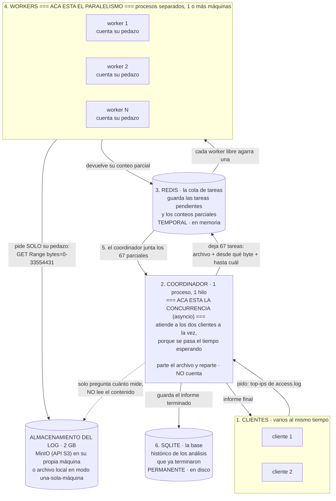
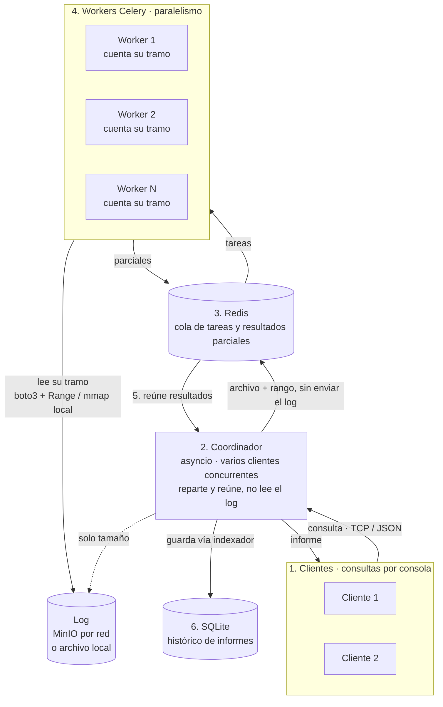
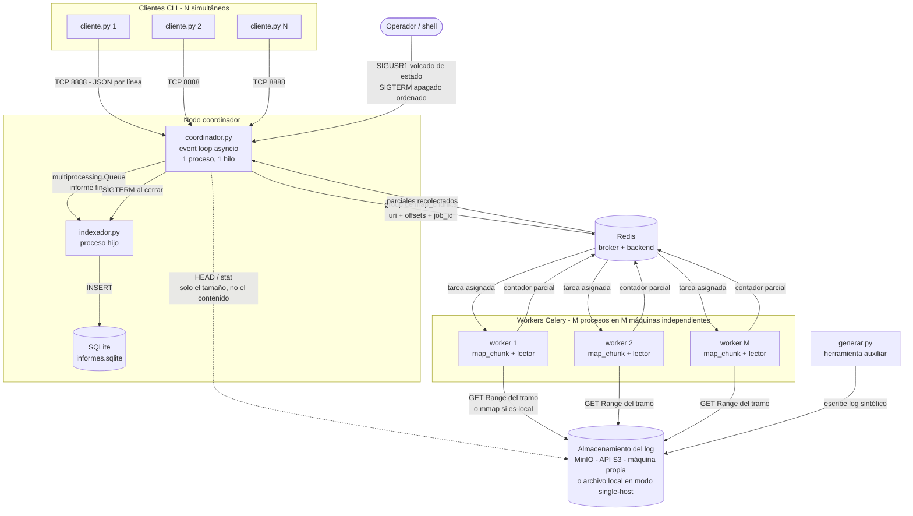
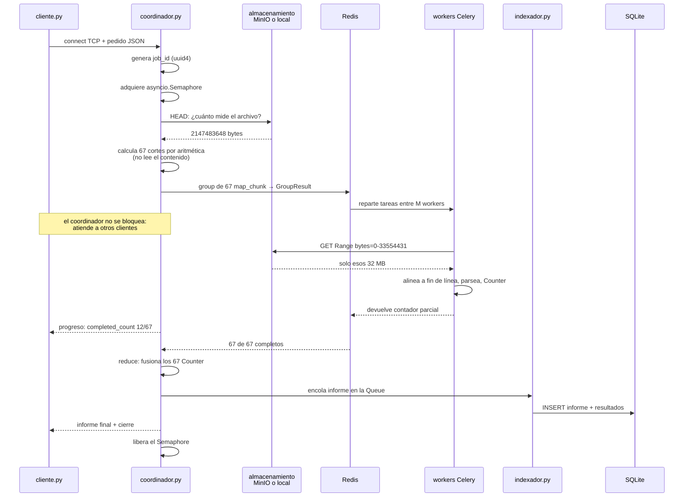
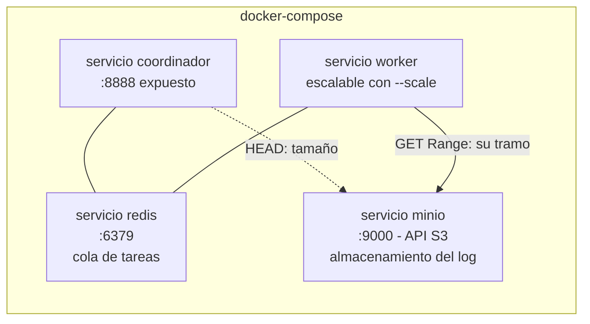

# 2. Arquitectura

## 2.1. Gráfico de la arquitectura

Hay dos versiones del mismo diagrama: una **simple**, para explicar en voz alta, y
una **completa**, con todos los mecanismos. Arrancá por la simple.

### Versión simple (la que uso para explicar)



### Versión con menos texto



### El guion para explicarlo

Señalá cada número mientras lo decís. Son seis pasos y dura un minuto.

> **1.** *"Acá arriba están los **clientes**: un programa de consola donde yo escribo
> qué quiero saber. Por ejemplo: dame las 10 IPs que más entraron a `access.log`. Y
> dibujé dos a propósito, porque pueden pedir cosas distintas al mismo tiempo."*
>
> **2.** *"El **coordinador** es el servidor, y acá pasan dos cosas. La primera:
> **él no cuenta nada, y de hecho ni lee el archivo**. Lo único que hace es
> preguntarle al almacenamiento cuánto mide y dividir: 2 GB cortados cada 32 MB me
> dan 67 pedazos. Eso es una división, no una lectura.*
>
> *La segunda, y acá está la **concurrencia**: es **un solo proceso con un solo
> hilo**, y aun así atiende a los dos clientes a la vez. Puede hacerlo porque se
> pasa casi todo el tiempo esperando: espera el pedido, espera a los workers, espera
> que el socket se vacíe. Cada vez que empieza a esperar, aprovecha y atiende al
> otro. Nunca hay dos cosas ejecutándose a la vez acá; hay una sola que nunca se
> queda quieta."*
>
> **3.** *"Deja una tarea por pedazo en una **cola de tareas**, que vive en Redis. Y
> acá está la decisión más importante del diseño: por la cola **no viajan los
> datos**. Viaja un papelito que dice 'archivo tal, del byte 0 al 33 millones'. Son
> 100 bytes. Si mandara los pedazos serían 2 GB pasando por Redis.*
>
> *Y ojo con esto: **Redis no es la base de datos del proyecto**. Es la cola. Guarda
> las tareas que todavía nadie agarró y los conteos parciales que van volviendo,
> nada más. Es temporal y vive en memoria: cuando el análisis termina, eso se
> borra."*
>
> **4.** *"Los **workers** son los que trabajan de verdad. Cada uno agarra una tarea
> de la cola, abre el archivo él mismo, lee **solamente su pedazo**, cuenta las IPs
> que encuentra ahí y devuelve su conteo parcial.*
>
> *Y acá está el **paralelismo**, que es distinto de lo de antes: estos son
> **procesos separados**, corriendo en núcleos distintos y **en máquinas distintas**,
> haciendo cuentas **literalmente al mismo tiempo**. Acá sí hace falta que sean
> varios, porque contar no es esperar, es trabajo. Puedo tener 1 o 10, y es lo único
> que cambio para que el análisis vaya más rápido: con 1 tarda 148 segundos, con 4
> tarda 41.*
>
> *Y pueden estar en otras máquinas porque el archivo **no vive en la máquina del
> worker**: vive en un almacenamiento aparte al que todos le piden su tramo por red.
> Así puedo sumar máquinas sin tocar el servidor web ni copiar los 2 GB a ningún
> lado."*
>
> **5.** *"Cuando vuelven los 67 parciales, el coordinador los **suma**: si el worker
> 1 vio 300 veces una IP y el worker 2 la vio 250, el total es 550. Eso arma el
> informe final y se lo manda al cliente que lo pidió."*
>
> **6.** *"Y el informe terminado lo guarda en **SQLite**, que sí es la base de datos
> del proyecto: ahí queda el histórico permanente de los análisis que corrí, con
> cuánto tardó cada uno y con cuántos workers. Es lo que me permite mostrar la tabla
> de tiempos sin cronometrar a mano."*

### Redis y SQLite: las dos guardan cosas, pero no lo mismo

Es la confusión más fácil de este diagrama, porque los dos se dibujan como un
cilindro y los dos "son bases". **No cumplen el mismo rol y no son intercambiables.**

| | **Redis** (caja 3) | **SQLite** (caja 6) |
|---|---|---|
| **Qué es acá** | La **cola de trabajo**. Un lugar de paso | La **base de datos**. Un lugar de archivo |
| **Qué guarda** | Las 67 tareas que todavía nadie agarró, y los conteos parciales que van volviendo de los workers | Un informe por análisis terminado: qué archivo, qué consulta, cuánto tardó, con cuántos workers, y el resultado |
| **Cuánto dura** | Segundos. Cuando el análisis termina, se borra | Para siempre, hasta que yo borre el archivo |
| **Dónde vive** | En **memoria RAM**, en un servicio aparte (puerto 6379) | En **disco**, en un archivo `informes.sqlite` |
| **Quién escribe** | El coordinador (encola tareas) y los workers (dejan parciales) | Solo el indexador, nadie más |
| **Si lo apago, ¿qué pierdo?** | El análisis que estaba en curso, nada más | El histórico entero |
| **Por qué no uso uno solo** | Redis no sirve para el histórico: es volátil y no sabe hacer consultas tipo "mostrame todos los análisis del último mes" | SQLite no sirve de cola: es un archivo en disco, bloqueante, y no sabe repartir trabajo entre máquinas |

**La frase si pregunta:** *"Redis es la cola donde pongo el trabajo pendiente;
SQLite es donde guardo el resultado cuando ya terminó. Uno es el riel de pedidos de
la cocina, el otro es el libro de ventas del día."*

### Dónde está la concurrencia y dónde el paralelismo

Las dos están marcadas en el diagrama, en cajas distintas, a propósito:

| | **Concurrencia** (caja 2) | **Paralelismo** (caja 4) |
|---|---|---|
| **Quién** | El coordinador | Los workers |
| **Qué hace a la vez** | Atiende a varios **clientes** | Cuenta varios **pedazos del archivo** |
| **Con qué** | `asyncio`: **1 proceso, 1 hilo** | **Varios procesos** separados (Celery) |
| **Por qué así** | Porque atender es casi todo **esperar**, y esperar no necesita más de un hilo | Porque contar es **trabajo** de CPU, y para eso hacen falta núcleos distintos |
| **Qué pasa si pongo más** | Nada: más hilos no sirven de nada, el cuello de botella no está ahí | Va más rápido: `148 s → 79 s → 41 s` con 1, 2 y 4 |

**El ejemplo para fijarlo:** *el coordinador es el mozo y los workers son los
cocineros.* Un mozo solo atiende 20 mesas sin problema, porque después de tomar el
pedido solo espera. Pero con un solo cocinero la cocina se tapa, porque cocinar no
es esperar, es trabajo. **El mozo no cocina y los cocineros no atienden mesas.**

### Las tres cosas que tienen que quedar claras del dibujo

Si de este diagrama se entienden estas tres, ya está explicado:

| | La idea | Cómo la señalo en el dibujo |
|---|---|---|
| **1** | **El coordinador reparte, no procesa.** Es el que organiza el trabajo, no el que lo hace | Su flecha al almacenamiento es punteada y solo pregunta *el tamaño*; la flecha que *lee de verdad* sale de los workers |
| **2** | **Por la cola viajan direcciones, no datos.** El archivo no se mueve de donde está | La etiqueta de la flecha al Redis: *"archivo + desde qué byte + hasta cuál"*. Los 2 GB nunca entran a la cola: cada worker va a buscar su tramo directamente al almacenamiento |
| **3** | **Los workers son intercambiables y escalables.** Ninguno es especial, no guardan nada entre tareas | La caja de workers tiene varios adentro y dice *"N"*: agregar uno es lanzar un proceso más contra el mismo Redis |

### Si te pregunta por lo que falta en este dibujo

El diagrama simple deja afuera tres cosas a propósito, y conviene tener la respuesta
lista porque es muy probable que las note:

- **"¿Y cómo hace el coordinador para atender a dos a la vez si es un solo hilo?"**
  → Va alternando. Cada vez que una conexión se queda esperando algo (el pedido del
  cliente, los parciales de los workers), el coordinador suelta esa y atiende la
  otra. Nunca ejecuta dos cosas al mismo tiempo: ejecuta una sola, pero nunca se
  queda quieto. En el diagrama completo esto se ve como N clientes apuntando a la
  misma caja.
- **"¿Y los mecanismos de IPC?"** → Están en el diagrama completo: `mmap` entre
  coordinador y workers vía el archivo, una `Queue` hacia el proceso que escribe en
  la base, contadores compartidos con `Lock`, y señales desde la terminal.
- **"¿Quién escribe en la base?"** → Un proceso aparte, el indexador, justamente
  para que esperar al disco no frene la atención de los clientes. En el simple lo
  dibujé como una flecha directa para no cargar el dibujo.
- **"Si los workers están en otra máquina, ¿cómo leen el archivo?"** → Le piden al
  almacenamiento **solo su tramo**, con un `GET` y una cabecera
  `Range: bytes=0-33554431`. Es el mismo concepto de mandar coordenadas en vez de
  datos, pero sobre HTTP en lugar de sobre el filesystem. Está desarrollado en §2.6.

### Versión completa (nodos, conectividad y mecanismos de IPC)

Diagrama de nodos, conectividad y mecanismos de IPC. Es el mismo sistema que el de
arriba, con todo lo que el simple deja afuera.



#### Versión ASCII

Equivalente al diagrama completo, para contextos donde Mermaid no se renderiza.

```text
    ┌─────────────┐   ┌─────────────┐   ┌─────────────┐
    │ cliente.py  │   │ cliente.py  │   │ cliente.py  │   N clientes
    │      1      │   │      2      │   │      N      │   simultáneos
    └──────┬──────┘   └──────┬──────┘   └──────┬──────┘
           │                 │                 │
           └─────────────────┼─────────────────┘
                             │  TCP :8888  (JSON delimitado por línea)
                             ▼
 ╔═══════════════════════════════════════════════════════════════════╗
 ║  NODO COORDINADOR                                                 ║
 ║                                                                   ║
 ║   ┌───────────────────────────────────────────────────────┐       ║
 ║   │  coordinador.py        1 proceso · 1 hilo · asyncio   │       ║
 ║   │                                                       │       ║
 ║   │   · asyncio.start_server   → N clientes concurrentes  │       ║
 ║   │   · tamaño + aritmética    → cálculo de cortes        │       ║
 ║   │   · group(map_chunk.s)     → despacho a Celery        │       ║
 ║   │   · GroupResult            → correlación y progreso   │       ║
 ║   │   · reduce                 → fusión de parciales      │       ║
 ║   │   · asyncio.Semaphore      → tope de jobs pesados     │       ║
 ║   └───────┬──────────────────────────────────┬────────────┘       ║
 ║           │ multiprocessing.Queue            │ Value + Lock       ║
 ║           ▼                                  ▼                    ║
 ║   ┌──────────────────┐            (contadores compartidos:        ║
 ║   │  indexador.py    │             jobs activos, informes)        ║
 ║   │  proceso hijo    │                                            ║
 ║   └────────┬─────────┘                                            ║
 ║            │ INSERT                                               ║
 ║            ▼                                                      ║
 ║   ┌──────────────────┐                                            ║
 ║   │ informes.sqlite  │                                            ║
 ║   └──────────────────┘                                            ║
 ╚═══════════════════════════════════════════════════════════════════╝
           │                                    ▲
           │ group(map_chunk.s(uri,ini,fin))    │ contadores parciales
           ▼                                    │
    ┌──────────────────────────────────────────────────┐
    │  Redis   ·  broker (tareas) + backend (results)  │
    └──────────────────────────────────────────────────┘
           │                                    ▲
           ▼                                    │
    ┌─────────────┐   ┌─────────────┐   ┌─────────────┐
    │  worker 1   │   │  worker 2   │   │  worker M   │   Celery
    │  map_chunk  │   │  map_chunk  │   │  map_chunk  │   1+ máquinas
    └──────┬──────┘   └──────┬──────┘   └──────┬──────┘
           │                 │                 │   (en máquinas
           └─────────────────┼─────────────────┘    independientes)
                             │ GET Range: bytes=ini-fin   (sólo su tramo)
                             │ ó mmap, si el backend es local
                             ▼
    ┌──────────────────────────────────────────────────┐
    │  Almacenamiento del log                          │
    │  MinIO (API S3) en su propia máquina   ·  ó      │ ◄── generar.py
    │  archivo local, en modo una-sola-máquina         │
    └──────────────────────────────────────────────────┘

   Señales:   shell ──SIGUSR1/SIGTERM──► coordinador ──SIGTERM──► indexador
```

## 2.2. Ciclo de vida de un pedido



### Detalle: cómo no se mezclan dos pedidos simultáneos

Si tres clientes piden análisis a la vez, por Redis circulan 201 tareas y 201
conteos parciales. **El coordinador nunca tiene que adivinar de quién es cada
parcial**, por tres razones:

| Pregunta | Respuesta |
|---|---|
| **¿Cómo identifico un pedido?** | Al aceptarlo, el coordinador genera un `job_id` (`uuid4().hex`) y lo guarda en su diccionario de jobs activos junto al `writer` del cliente, el archivo, la consulta y la hora de inicio |
| **¿Cómo sé qué parciales son de ese pedido?** | Las 67 tareas no se encolan sueltas: se encolan como un **`group` de Celery**, que devuelve un **`GroupResult`** con su propio id. Ese objeto es el que agrupa esos 67 resultados y ningún otro. No hay una bolsa común de parciales: hay un `GroupResult` por job |
| **¿Cómo sé cuántos faltan?** | `GroupResult.completed_count()` devuelve cuántas de las 67 terminaron. Es el mismo número que le mando al cliente como progreso |
| **¿Cómo sé que ya están todos?** | Cuando `completed_count() == len(cortes)`, o directamente con `GroupResult.ready()`. Recién entonces hace el *reduce* |
| **¿Y si uno no vuelve nunca?** | Cada job tiene un `--job-timeout` (300 s por defecto). Si vence, se revocan las tareas pendientes de **ese** `GroupResult`, se le informa el error a **ese** cliente y se libera el `Semaphore`. Los demás clientes no se enteran |
| **¿Y si un worker se muere a mitad de un tramo?** | Celery reentrega esa tarea a otro worker. Es seguro porque `map_chunk` es idempotente: contar el mismo tramo dos veces da el mismo resultado |

El recorrido de un parcial, entonces, es: worker → backend de resultados de Redis
**bajo el id de su tarea** → `GroupResult` del job que la encoló → `job_id` →
diccionario de jobs activos → `writer` del cliente que lo pidió.

## 2.3. Nodos

| Nodo | Tipo | Cantidad | Rol |
|---|---|---|---|
| `cliente.py` | Proceso CLI | N | Emite el pedido y muestra el informe |
| `coordinador.py` | Proceso asyncio | 1 | Acepta clientes, corta el archivo, despacha, hace el reduce |
| `indexador.py` | Proceso hijo | 1 | Persiste informes en SQLite |
| worker Celery | Proceso | M (escalable, en M máquinas) | Ejecuta el *map* sobre un tramo |
| Redis | Servicio | 1 | Broker de tareas y backend de resultados |
| SQLite | Archivo | 1 | Histórico de informes |
| **Almacenamiento del log** | Servicio (MinIO) o filesystem | 1 | Aloja los logs. En modo distribuido es un servicio con API S3 en su propia máquina; en modo single-host, un archivo local |
| `lector.py` | Módulo | — | Abstracción de lectura por rango de bytes. Dos backends: `local://` con `mmap` y `s3://` con `GET Range`. Los workers lo usan para leer su tramo; el coordinador, solo para preguntar el tamaño |
| `generar.py` | Proceso CLI | — | Fabrica logs sintéticos de prueba, locales o subidos al bucket |

## 2.4. Conectividad

| Canal | Entidades | Transporte | Formato | Por qué |
|---|---|---|---|---|
| Pedido/informe | cliente ↔ coordinador | **TCP** (`asyncio.start_server`) | JSON delimitado por `\n` | El informe no puede perderse ni llegar desordenado: STREAM, no DGRAM. El delimitador de línea evita tener que inventar un framing por longitud |
| Despacho de tareas | coordinador → Redis → workers | TCP (protocolo Redis) | Serialización de Celery | Cola distribuida: desacopla al coordinador de la cantidad y ubicación de los workers |
| Devolución de parciales | workers → Redis → coordinador | TCP (protocolo Redis) | Serialización de Celery | Mismo canal en sentido inverso, usando Redis como *backend* de resultados |
| Tamaño del log | coordinador → almacenamiento | `HEAD` (S3) o `os.stat` (local) | Un entero | El coordinador necesita el tamaño para calcular los cortes, pero **no** el contenido |
| Lectura de un tramo | worker → almacenamiento | **HTTP `GET` + `Range: bytes=ini-fin`** (S3), o `mmap` (local) | Bytes crudos | Cada worker trae **solo su tramo**. Los `Range` requests son el mismo concepto de mandar coordenadas, pero sobre HTTP: permiten que el worker viva en otra máquina sin copiar los 2 GB. Ver 2.6 |
| Informe a persistir | coordinador → indexador | `multiprocessing.Queue` | Objeto Python | Procesos emparentados en la misma máquina; la Queue ya resuelve serialización y sincronización |
| Control | shell → coordinador → indexador | Señales POSIX | — | Notificación asincrónica sin canal previo establecido |

## 2.5. Mecanismos de IPC a implementar

| Mecanismo | Entre quiénes | Para qué | Justificación |
|---|---|---|---|
| **`mmap`** | workers del mismo host, vía el archivo | Backend `local://` del lector: cada worker mapea **solo su tramo** | Memoria compartida respaldada por archivo. El kernel no copia a espacio de usuario, trae páginas por demanda, y los procesos que mapean el mismo archivo **comparten las páginas físicas de la caché**: el log no se duplica en memoria por worker. Es el IPC más eficiente para datos de este volumen, y el camino rápido cuando todo corre en una máquina |
| **`multiprocessing.Queue`** | coordinador → indexador | Entregar el informe final para que se persista | Internamente es un pipe con lock y serialización. Hace la escritura en disco asincrónica respecto de la respuesta al cliente: un `INSERT` lento no demora al cliente |
| **`multiprocessing.Value` + `Lock`** | coordinador ↔ indexador | Contadores compartidos: jobs activos, informes persistidos, líneas totales | Memoria compartida para dato escalar. El `Lock` es obligatorio: `+= 1` no es atómico (es *read-modify-write*), y es exactamente la condición de carrera vista en clase |
| **Señales POSIX** | shell → coordinador → indexador | `SIGUSR1` volcar estado; `SIGINT`/`SIGTERM` apagado ordenado con revocación de tareas | Comunicación asincrónica sin canal preestablecido. Permite inspeccionar y apagar el sistema sin un puerto de administración |
| **Cola distribuida (Redis)** | coordinador ↔ workers | IPC *entre máquinas* para el **trabajo** | Los mecanismos anteriores son locales a un host. Para cruzar la frontera de la máquina hace falta una cola por red |
| **API S3 (MinIO)** | workers ↔ almacenamiento | IPC *entre máquinas* para los **datos** | Redis transporta las coordenadas, pero el worker igual tiene que leer los bytes. Los `Range` requests le dan acceso a su tramo sin estar en la máquina del archivo y sin traerse los 2 GB |

### Detalle: condiciones de carrera **dentro** de asyncio

Es tentador decir que con un solo hilo no hay condiciones de carrera. **Es verdad a
medias y conviene decirlo con precisión**, porque es la pregunta fina de este
diseño:

- **Lo que `asyncio` sí elimina:** las *data races*. El cambio de contexto ocurre
  únicamente en los `await`, que están escritos y son visibles. Nadie puede
  interrumpir al coordinador en la mitad de un `+= 1`, así que sobre el estado
  propio del coordinador no hace falta un `Lock` como el del `Value` compartido.
- **Lo que NO elimina:** las carreras **lógicas que cruzan un `await`**. Si una
  corrutina lee un valor, hace `await` de algo, y después escribe en función de lo
  que leyó, otra corrutina pudo correr en el medio y cambiarlo. El patrón peligroso
  es *leer → `await` → decidir/escribir*:

```python
# MAL: la invariante se rompe en el await
if len(self.jobs) < self.max_jobs:      # A y B pasan el chequeo
    await self.preparar_job()           # ← cede el control: entra B
    self.jobs[job_id] = job             # terminan 2 jobs con max_jobs=1
```

**Las dos formas de evitarlo en este proyecto:**

1. **No ceder el control dentro de la sección crítica**: leer, decidir y escribir
   sin ningún `await` en el medio. El bloque queda atómico por construcción.
2. **Un `asyncio.Lock`** cuando la sección crítica necesita esperar algo. Es el
   caso del tope de análisis simultáneos, que se resuelve con un
   `asyncio.Semaphore(--max-jobs)`: se adquiere **antes** de empezar y se libera al
   terminar, en lugar de chequear un contador a mano.

**Dónde está el riesgo concreto acá:** el diccionario de jobs activos y los
contadores de progreso, que se tocan desde varias corrutinas. Se revisa que ninguna
secuencia *leer → `await` → escribir* los involucre, y donde haga falta esperar
dentro de la sección crítica va un `asyncio.Lock`.

> Dicho corto: **el `Lock` de `multiprocessing` protege contra el sistema operativo;
> el `asyncio.Lock` protege contra mis propios `await`.** Son dos problemas
> distintos y los dos están en el proyecto.

### Detalle: por qué el `Lock` no es opcional

Si el coordinador hace `jobs_activos.value += 1` mientras el indexador lee o
escribe el mismo `Value`, la operación se compone de tres pasos no atómicos (leer,
sumar, escribir) y un cambio de contexto en el medio produce una actualización
perdida. El `Lock` serializa el acceso a la sección crítica. Es el mismo error que
se reproduce en `th_errorcontador.py` de la cátedra.

## 2.6. Decisión central: coordenadas en vez de datos

Para que varios procesos analicen un archivo de 2 GB hay dos opciones:

| | Enviar los datos | **Enviar las coordenadas** (elegida) |
|---|---|---|
| Qué viaja por la cola | Los bytes de cada tramo: 2 GB serializados | `(uri, inicio, fin)`: ~100 bytes por tarea |
| Carga sobre Redis | 2 GB de tráfico y memoria | Despreciable |
| Costo en el worker | Deserializar 32 MB antes de empezar | Trae directo su rango, por demanda |
| Requisito | Ninguno | El worker tiene que poder **leer un rango** del archivo por su cuenta |

Se elige la segunda. Lo que define la arquitectura es, entonces, **cómo accede un
worker a un rango de bytes de un archivo que no está en su máquina.**

### El acceso al archivo: dos backends detrás de una misma interfaz

El módulo `lector.py` expone una interfaz mínima —`tamano()` y
`leer(inicio, fin)`— con dos implementaciones que se eligen por el esquema de la
URI que el cliente pasa en `--file`:

| | **`local:///data/access.log`** | **`s3://logs/access.log`** (MinIO) |
|---|---|---|
| Cómo lee el rango | `mmap` del archivo, páginas por demanda | `GET` con cabecera `Range: bytes=inicio-fin` |
| Cómo pide el tamaño | `os.stat().st_size` | `HEAD` del objeto (`Content-Length`) |
| Copias de datos | Ninguna: el kernel mapea y comparte las páginas de la caché entre los workers del mismo host | Una: el tramo viaja por la red hasta el worker |
| Dónde pueden vivir los workers | **Solo en la máquina del archivo** | **En cualquier máquina** |
| Para qué está | Camino rápido en una sola máquina, y es el mecanismo de **IPC por memoria compartida** del proyecto | Escalado horizontal real: sumar máquinas sin tocar el servidor web |

**Por qué los dos y no uno solo.** El backend local con `mmap` es el más eficiente
posible —cero copias, páginas compartidas— pero ata los workers a la máquina donde
está el log, que típicamente es el servidor web: ahí ya corren nginx y sus
servicios, y agregarle M workers no escala. El backend S3 resuelve exactamente eso:
el log vive en su propio servicio y cualquier máquina puede pedir su tramo. Tener
los dos detrás de la misma interfaz permite demostrar ambas cosas sin duplicar el
worker, que no sabe cuál de los dos está usando.

**Por qué S3/MinIO y no NFS.** NFS no requiere cambiar una línea de código —se monta
en `/data` y `mmap` sigue andando— pero exige administrar un servidor NFS, la
coherencia de caché de `mmap` sobre NFS es frágil, y no aporta nada conceptualmente.
La API S3 es un estándar, se levanta con una imagen de Docker, y sus `Range`
requests son **literalmente** el diseño de coordenadas de este proyecto expresado
sobre HTTP. Se elige MinIO por ser una implementación libre de esa API.

### Detalle: el corte alineado a fin de línea

Cortar cada 32 MB a ciegas partiría un registro al medio, y esa línea se perdería o
se contaría dos veces. Pero el coordinador **no puede resolverlo leyendo el
archivo**: en modo S3 eso significaría bajarse los 2 GB solo para buscar saltos de
línea, que es justamente lo que el diseño evita.

Entonces la alineación **la hace cada worker sobre su propio tramo**, con dos reglas
que no requieren coordinación entre ellos:

1. **Descartar la primera línea parcial.** Si `inicio > 0`, el worker ignora todo
   lo que haya hasta el primer `\n` inclusive: esa línea le pertenece al tramo
   anterior. El worker del tramo 0 no descarta nada.
2. **Completar la última línea.** El worker lee hasta `fin` y, si la última línea
   quedó cortada, pide un pedazo más allá de `fin` (una "cola" de 64 KB alcanza
   para cualquier línea de log) hasta encontrar el primer `\n`.

Como cada worker descarta su primera línea parcial y completa su última, cada línea
del archivo es contada por **exactamente un** worker: los tramos quedan disjuntos y
cubren el archivo completo. Es el mismo algoritmo que usa el `TextInputFormat` de
Hadoop.

**Lo que se gana con el cambio:** el coordinador deja de leer el archivo por
completo. Solo pide el tamaño y divide, lo que refuerza su rol —reparte, no
procesa— y lo deja libre para funcionar sin acceso al contenido del log.

## 2.7. Concurrencia y paralelismo: dos modelos conviviendo

| Dónde | Naturaleza de la carga | Modelo | Por qué no el otro |
|---|---|---|---|
| Coordinador | I/O-bound (esperar sockets y resultados) | `asyncio`, 1 hilo | Hilos o procesos por cliente: costo innecesario y *data races* evitables. El GIL no molesta porque casi no hay cómputo. (Sobre las carreras que `asyncio` **no** elimina, ver el detalle de §2.5) |
| Workers | CPU-bound (regex sobre millones de líneas) | Procesos Celery, en máquinas independientes | `asyncio` no acelera cómputo; los hilos tampoco, por el GIL. Hacen falta procesos sobre núcleos distintos, y para escalar de verdad, sobre máquinas distintas |

Que las dos estrategias convivan en una misma aplicación, cada una donde
corresponde, es el aporte conceptual del proyecto.

## 2.8. Almacenamiento

```sql
CREATE TABLE informes (
    id            INTEGER PRIMARY KEY AUTOINCREMENT,
    ts            REAL    NOT NULL,   -- cuándo se corrió el análisis
    archivo       TEXT    NOT NULL,
    tamano_bytes  INTEGER NOT NULL,
    query         TEXT    NOT NULL,
    chunks        INTEGER NOT NULL,   -- tramos en que se partió
    workers       INTEGER,            -- concurrencia observada
    lineas        INTEGER NOT NULL,
    invalidas     INTEGER NOT NULL,
    duracion      REAL    NOT NULL    -- segundos; permite comparar speedup
);

CREATE TABLE resultados (
    informe_id INTEGER NOT NULL REFERENCES informes(id),
    clave      TEXT    NOT NULL,      -- IP, código, URL u hora
    valor      INTEGER NOT NULL,
    PRIMARY KEY (informe_id, clave)
);
```

Se elige **SQLite** porque el volumen es bajo (un informe por análisis, no una
fila por línea de log), no requiere servidor —simplifica el `INSTALL.md`— y un
único escritor alcanza, dado que el indexador es el único proceso que escribe.
Guardar `duracion` y `workers` es lo que permite construir la tabla de *speedup*
con datos del propio sistema, en lugar de cronometrar a mano.

## 2.9. Despliegue



```bash
docker compose up -d --scale worker=4
```

**Ningún servicio comparte filesystem con otro.** El log vive dentro de MinIO y
tanto el coordinador como los workers lo alcanzan por HTTP contra `minio:9000`, así
que los workers pueden escalar a otras máquinas sin más que apuntar a la misma URL
de Redis y a la misma de MinIO. Escalar el paralelismo es cambiar un número en
`--scale`, sin tocar una línea de código.

Para desarrollo en una sola máquina se puede omitir MinIO y usar un `--file`
`local://`, que es el camino con `mmap`.

## 2.10. Ajustes acordados con el profesor

Registro de los cambios pedidos en la reunión de aprobación de la arquitectura
(`FINAL.md` exige que los cambios de requisitos se commiteen).

| Observación | Qué cambió |
|---|---|
| **Los workers quedaban atados a la máquina del log.** Al usar `mmap` sobre una ruta local, los workers tenían que correr en el mismo host que el archivo —típicamente el servidor web, que ya tiene nginx y sus servicios—. Eso impide escalar horizontalmente: haría falta "una máquina gigante" en lugar de varias chicas | Se introdujo `lector.py` con **dos backends** detrás de una interfaz común: `local://` con `mmap` y `s3://` con `GET Range` contra **MinIO**. Los workers ya pueden vivir en máquinas independientes. Ver §2.6 |
| Con el archivo remoto, el coordinador ya no puede recorrerlo para alinear los cortes a fin de línea | El coordinador pasa a calcular los cortes **por aritmética** sobre el tamaño (`HEAD`), y la alineación se mueve al worker con la regla *descartar la primera línea parcial / completar la última*. Ver §2.6 |
| **"¿Cómo sabe el coordinador de qué pedido es cada conteo parcial, y cuándo están todos?"** No estaba definido | Se definió `job_id` por pedido y un **`GroupResult`** de Celery por job, con `completed_count()` para el progreso y `ready()` para la finalización, más un `--job-timeout`. Ver el detalle de §2.2 |
| **"Si tenés un `await` dentro de una sección crítica, sí podés tener problemas de concurrencia"** | Se corrigió la afirmación de que asyncio "elimina de raíz" las condiciones de carrera: elimina las *data races*, no las carreras lógicas que cruzan un `await`. Se agregó el patrón peligroso, las dos formas de evitarlo y dónde está el riesgo en este sistema. Ver el detalle de §2.5 |
| Preguntó por el protocolo de capa de aplicación | Ya estaba decidido y documentado, pero no se mencionó en la presentación: **protocolo propio, JSON delimitado por `\n` sobre TCP**. Ver §2.4 |
| Flujo de trabajo en git | Sin requisitos: se trabaja en `main` con commits frecuentes e incrementales |
